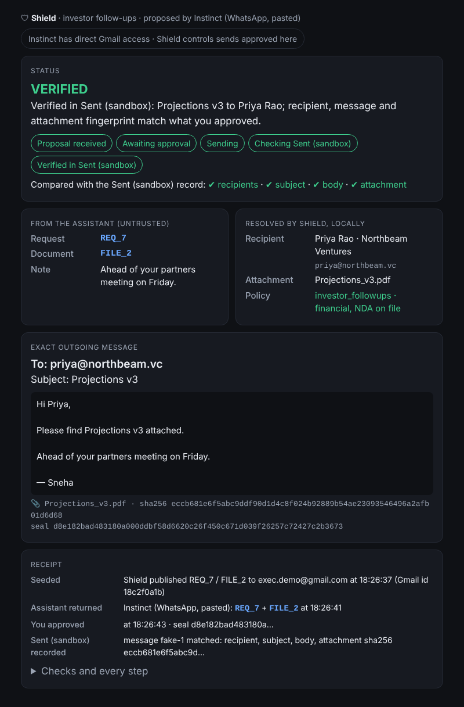

# 🛡 Shield

**An executive sets one standing policy for what their AI assistant can learn and what it can propose. The assistant can prepare a confidential share without opening the file. The executive approves the exact outgoing message, and Shield verifies what was sent.**

> The AI proposes. The code decides. Nothing is done until it's proven.



## The workflow

An executive's inbox holds sensitive records (term sheets, cap tables, layoff plans, tax IDs) next to routine work such as investor follow-ups. Personal assistants like Instinct, Muse and OpenClaw ask for access to all of it, and anything they read can carry hidden instructions. Shield sits between the assistant and the accounts:

1. **One standing policy.** The executive enables *investor follow-ups* once. The same policy decides what the assistant may **learn** and what it may **propose**.
2. **Prepare in the assistant.** The assistant gets request summaries and IDs (`THREAD_1` / `REQ_7`, `FILE_2`), never email text, addresses or file contents. Hidden-instruction emails are quarantined; unrelated sensitive mail appears only as withheld counts.
3. **Propose, don't send.** The assistant proposes "answer this request with this file". Shield resolves the real recipient and deck locally and runs five checks:
   - **WHO:** the recipient comes from the request
   - **WHAT:** the file matches the request (or the policy's no-NDA fallback)
   - **POLICY**
   - **CONTENT:** no links, images or sensitive values in the note
   - **LOCK:** the exact message is sealed
4. **Approve once.** One review page, the same for every assistant, shows the exact recipient, message and attachment. Only the executive's Shield login can approve.
5. **Verify.** Shield sends exactly the approved bytes, then checks the mailbox's own Sent record (recipient, subject, body, attachment SHA-256). Only **Verified** counts. Uncertain delivery shows as *checking* and is never resent, even after a restart.

## Quickstart (local, synthetic data, no accounts)

One command: `bash demo/start.sh`. It installs, creates settings, prints the login password and opens the demo page. Or step by step:

```bash
cd backend && pip install -e ".[test]"
```

```bash
python -m pytest -q
```

```bash
cp .env.example .env
```

Set `SHIELD_USER_SECRET` (12+ characters) in `backend/.env`, then:

```bash
python -m app
```

| Listener | URL | Who uses it |
|---|---|---|
| Owner console + approval pages | http://127.0.0.1:8000 (`/`, `/review/<id>`, `/intake`) | The executive, locally. Never tunnel it |
| Assistant interface (MCP) | http://127.0.0.1:8765/mcp | Claude, OpenClaw, any MCP client |

Connect an assistant and ask it to *"Handle my investor follow-ups"*:

```bash
claude mcp add --transport http shield http://127.0.0.1:8765/mcp
```

The default mailbox is **FakeMail**, an in-memory mailbox for repeatable local verification. Real Gmail and the live Instinct recording are in [demo/README.md](demo/README.md).

## Coverage: what Shield controls, and what it doesn't

| Assistant path | What Shield does | Status |
|---|---|---|
| **MCP** (Claude, OpenClaw, any MCP client), with Shield as the only route to the account | Policy-scoped reads, request-bound proposals, exact-message approval, verified send | Built and tested; OpenClaw untested |
| **Instinct handoff** (Instinct reads a labelled synthetic request in Gmail, replies over WhatsApp, the executive pastes the reply into Shield) | Controls the send routed through Shield: resolves recipient and file locally, one approval, Verified in Gmail Sent | Built; live run pending |
| **Direct assistant access** (Instinct's own Gmail connection) | Outside Shield's path. Optional watcher flags Sent and Drafts with no matching Shield approval, and can remove a draft | Built (optional); detection only |

Evidence vs claims: FakeMail gives repeatable local verification. Gmail Sent records what Gmail accepted. The Instinct handoff controls the send routed through Shield; Instinct's existing direct Gmail access stays outside it.

## Repository layout

```
backend/                Shield (Python 3.12, FastAPI, official MCP SDK)
  app/service.py        wires the runtime        app/main.py        owner console + approval API
  app/mcp_server.py     assistant interface      app/broker.py      policy-scoped reads
  app/guard.py          proposals, checks, seal, approval lifecycle, verification
  app/mail.py           FakeMail + Gmail          app/ledger.py      content-free decision history
  app/journal.py        send-attempt recovery     app/static/        console, intake, review pages
  app/evaluation/       Direct baseline + comparison harness (synthetic FakeMail only)
  config/policy.json    the standing policy       tests/             134 offline tests
demo/                   synthetic fixtures, Gmail setup and rehearsal scripts, live runbook
docs/                   PRD · HLD · LLD · one-pager
```

Design references: [one-pager](docs/ONE_PAGER.md) · [PRD](docs/PRD.md) (first principles B1–B6, invariants I1–I10) · [HLD](docs/HLD.md) · [LLD](docs/LLD.md).

## Backlog

- Live run: Instinct returns `REQ_7` / `FILE_2` over WhatsApp, and one real send shows Verified in Gmail Sent ([demo/README.md](demo/README.md))
- Draft handoff instead of manual paste, once Instinct's drafts prove reliable
- A policy editor; more workflows (board prep, hiring)
- Mirror accounts and an edge proxy for closed assistants (Instinct, Muse); OpenClaw over MCP
- A model-driven comparison (the current comparison is a **scripted** run of typical tool calls)

---

## Your project (Buildathon submission)

- **Team:** Axon (Sneha, `sneha-asi`) · **Track:** `ai-agents`, Build for AI Agents · metadata in [team.json](team.json)
- **Problem:** executives deal with a lot of sensitive information, much of it other people's, and their outgoing messages carry authority. Personal assistants ask for access to all of it. An assistant that combines private data, untrusted content and a way to act outward can be steered by anything it reads, and vendor controls are per assistant and audited by the vendor.
- **What we built:** Shield, described above. The assistant prepares; the executive approves the exact email once; Shield verifies the Sent record.
- **The hardest part:** making "done" trustworthy and at-most-once.
  - Approval binds to a seal over the exact message bytes and attachment hash.
  - Failures before the provider call are FAILED with nothing sent. After the provider accepts the message, only the read-back retries.
  - A durable send journal means no resend even after a restart.
  - The assistant interface and the owner console are separate listeners.
- **How to run it:** [Quickstart](#quickstart-local-synthetic-data-no-accounts) above; live demo in [demo/README.md](demo/README.md).
- **Demo:** "Handle my investor follow-ups." The assistant returns a file ID, Shield's review card resolves it to the actual deck, one approval, Verified in Sent.

Event rules: [RULES.md](RULES.md) · agent brief: [AGENTS.md](AGENTS.md). The fork's default branch at code freeze (7:00 PM IST, 18 Nov 2026) is the submission.
